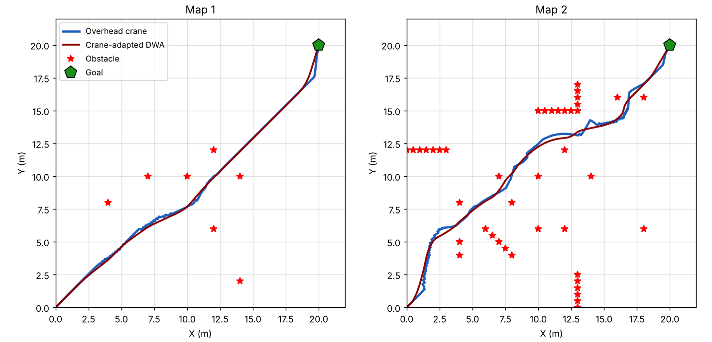

# ILQR-DWA-Crane
### Optimized Integral-LQR Control and Crane-Adapted Dynamic Window Approach for 3D Overhead Crane Path Planning

[](https://doi.org/10.1109/ICAC65379.2025.11196637)

MATLAB code for an integral LQR controller, tuned with Differential Evolution, that drives a 3D overhead crane along obstacle-free paths planned by a crane-adapted Dynamic Window Approach.

<p align="center">
  
</p>

*The DE-tuned crane (blue) tracking the crane-adapted DWA path (dark red) to the goal at (20, 20) on the two test maps, as in Figs. 7–8 of the paper.*

## Overview

Overhead cranes move heavy loads in factories, warehouses and construction sites. The main difficulty is positioning the trolley quickly and accurately while the payload swings, and doing it without hitting anything along the way. This project combines an optimally tuned controller with a local path planner:

| Component | What it does | Files |
|---|---|---|
| Linear crane model | Decoupled x and y subsystems: trolley position and velocity, sway angle and rate (paper eqs. 19–23) | `crane_model.m` |
| Integral LQR | State feedback plus integral action for zero steady-state position error | `integral_lqr_gains.m`, `simulate_integral_lqr.m` |
| DE tuning | Searches the LQR weights Q and R that minimize the tracking error (ITAE) | `main_deo_tuning.m`, `lqr_itae_cost.m`, `de.m` |
| Crane-adapted DWA | Plans x and y velocity commands that move toward the goal while avoiding obstacles | `dwa_crane_optimized.m` |

## How it works

1. The crane is modeled as two decoupled 4-state linear systems, one for each horizontal axis.
2. The integral LQR applies `u = z − K·x` with `ż = Ki·(r − y)`. K comes from `lqr`, and Ki is chosen so that each position output has unit DC gain (eq. 9).
3. Differential Evolution searches the 10 diagonal entries of Q and R (each between 1e-5 and 1000) to minimize the ITAE of a step to (20, 15) m. Unstable or poor candidates get a penalty cost of 1e6.
4. Every 0.1 s, the DWA samples (vx, vy) pairs inside the dynamic window, predicts each one 2 s ahead, scores it on heading toward the goal, clearance from obstacles and speed, and picks the best.
5. The DWA position at each step becomes the reference for the crane controller, which moves the trolley along the planned path.

## Results

Step response to (x, y) = (20, 15) m, conventional vs. DE-tuned integral LQR (Table II of the paper):

- Settling time is about 90% shorter in x and 86% shorter in y, and overshoot drops from about 37% to below 0.4%.
- The Lyapunov matrix of both closed loops is positive definite, so both are stable.
- With the DWA, the crane reaches the goal on both maps: map 1 has 7 obstacles and map 2 has 42.

## Getting started

### 1. Requirements

- MATLAB
- Control System Toolbox (`lqr`, `lyap`, `ss`, `lsim`, `stepinfo`)
- Statistics and Machine Learning Toolbox (`unifrnd`, used by `de.m`)

### 2. Install

```bash
git clone https://github.com/Ali-M-Mustafa/ILQR-DWA-Crane.git
cd ILQR-DWA-Crane/src
```

Run all scripts from inside `src/`.

## Repository structure

```
ILQR-DWA-Crane/
├── src/
│   ├── compare_controllers.m     # Table I, Table II, Lyapunov check, Figs. 4–6
│   ├── main_deo_tuning.m         # DE tuning of the LQR weights Q and R
│   ├── dwa_crane_optimized.m     # Crane-adapted DWA with the crane in the loop (Figs. 7–8)
│   ├── crane_model.m             # Linear crane model, eqs. 19–23
│   ├── integral_lqr_gains.m      # LQR gain K and integral gain Ki
│   ├── simulate_integral_lqr.m   # Closed-loop step response
│   ├── lqr_itae_cost.m           # ITAE cost function used by DE
│   └── de.m                      # Differential Evolution (adapted from Yarpiz YPEA107, MIT)
├── path_planning.png
├── LICENSE
├── LICENSE-YARPIZ
├── README.md
└── .gitignore
```

## Known limitations

- **Predictions also move the crane.** While the DWA evaluates candidate paths, each prediction step also advances the simulated crane. This contributes to the wiggles and corner overshoot in the crane path (Figs. 7–8) and makes runs slow. If the crane is advanced only once per step, it follows the DWA path almost exactly. A fix is planned.
- **The DWA has no collision filter.** Candidate paths are scored but never rejected, and clearance is measured only at the end of each predicted path.
- **The controller is tested on the linear model only.** There are no actuator limits; the DE-tuned input peaks at about 3.8×10⁴.


## Publication

If you use this code, please cite:

A. M. Mustafa, B. Brahmi, and N. Iqbal, "Optimized Integral-LQR Control and Crane-Adapted Dynamic Window Approach Algorithm for 3D Overhead Crane Path Planning," in *2025 30th International Conference on Automation and Computing (ICAC)*, 2025, doi: 10.1109/ICAC65379.2025.11196637.

```bibtex
@inproceedings{mustafa2025crane,
  author    = {Mustafa, Ali M. and Brahmi, Brahim and Iqbal, Naveed},
  title     = {Optimized Integral-LQR Control and Crane-Adapted Dynamic Window Approach Algorithm for 3D Overhead Crane Path Planning},
  booktitle = {2025 30th International Conference on Automation and Computing (ICAC)},
  year      = {2025},
  publisher = {IEEE},
  doi       = {10.1109/ICAC65379.2025.11196637}
}
```

## License

The project code is released under the [MIT License](LICENSE).

Third-party code:
- `de.m` is adapted from Mostapha Kalami Heris, *Differential Evolution (DE) in MATLAB* (YPEA107), Yarpiz, 2015 ([website](https://yarpiz.com/differential-evolution-ypea107), [GitHub](https://github.com/smkalami/ypea107-differential-evolution)). MIT License, see [LICENSE-YARPIZ](LICENSE-YARPIZ). Change: the problem size and bounds are passed as arguments.
- `dwa_crane_optimized.m` is adapted from `DynamicWindowApproachSample.m` in Atsushi Sakai's [MATLABRobotics](https://github.com/AtsushiSakai/MATLABRobotics), Copyright (c) 2014 Atsushi Sakai, Modified BSD License. Changes: holonomic (vx, vy) velocity window, a new goal and clearance evaluation, and the DE-tuned crane controller in the loop.

The Dynamic Window Approach itself is from D. Fox, W. Burgard and S. Thrun, "The Dynamic Window Approach to Collision Avoidance," *IEEE Robotics & Automation Magazine*, vol. 4, no. 1, pp. 23–33, 1997.
